  

  
  
  
  

## 🦷 Presenting complaint

Hi, I'm Ibrahim. Oral surgery registrar at UCL Eastman in London. By day I take out wisdom teeth, by night I write code that measures how close they sit to the nerve.

The tooth in the scan up there is 0.4 mm from the canal. That is the kind of number that keeps a surgeon up at night, so I figured I might as well be up writing software about it.

## 🩻 The main procedure: CANDID

The main thing I'm building is **[CANDID](https://candidlabs.org)**. You give it a CBCT scan and it finds the lower third molar and the nerve canal, then measures the gap in millimetres.

- **It measures.** Third molar to inferior alveolar canal, in mm, with the anatomy graded.
- **It withholds.** If it isn't sure, it won't give you a number, and honestly I wish more software did that.
- **It stays put.** It runs locally, so scans never leave the machine.

It's research software, not a medical device. The project page has the evidence and the limitations, including the unflattering ones: **[candidlabs.org](https://candidlabs.org)**. A small slice of the code lives in **[CANDID](https://github.com/ibrahimalroudhan-cmyk/CANDID)**.

## 📈 Obs

Taken every morning by a nurse who is actually a GitHub Action. Private work is counted, but it stays under the drape.

## 😬 The last four weeks, as an OPG

One tooth per day, charted 17 → 27 then 37 → 47, so today is always the lower right seven. The more I shipped, the more work the tooth has had. The busiest day gets an implant, because that tooth is not coming back. The wisdom teeth carry no data; they are impacted on principle.

## 🧰 On the tray

I lean a lot on other people's great work: [nnU-Net](https://github.com/MIC-DKFZ/nnUNet) · [MONAI](https://github.com/Project-MONAI/MONAI) · [3D Slicer](https://github.com/Slicer/Slicer) · [SimpleITK](https://github.com/SimpleITK/SimpleITK) · [pydicom](https://github.com/pydicom/pydicom) · [TotalSegmentator](https://github.com/wasserth/TotalSegmentator) · [ToothFairy](https://github.com/AImageLab-zip/ToothFairy)

  

## 📚 Dental history

- **Thesis, 2026.** *Validating automated measurement of the mandibular third molar to inferior alveolar canal relationship on CBCT.* MClinDent (Oral Surgery), UCL Eastman Dental Institute. Submitted, under examination.
- **Manuscript, 2026.** *Automated measurement of the third molar to inferior alveolar canal relationship: audit, public-data retraining and blind verification.* Written, and waiting for me to pick a journal.
- **2020–21.** A few papers on N95 masks, mouthwashes, root canals and cephalometrics, back when I had more free evenings.

## 🪥 Side quests

- **[fc-apple-skin](https://github.com/ibrahimalroudhan-cmyk/fc-apple-skin)**: an Obsidian plugin that makes Full Calendar Remastered look and behave like Apple Calendar. Display only. It never writes to your calendars.
- **This page.** The radiographs redraw themselves every morning from [`scripts/build.py`](scripts/build.py). Help yourself if you want an OPG of your own commit history.

## 📞 Recall

Say hi: [Ibrahim@candidlabs.org](mailto:Ibrahim@candidlabs.org) · [LinkedIn](https://www.linkedin.com/in/ibrahim-alroudhan-a3b733216/) · [candidlabs.org](https://candidlabs.org)

📋 Post-op instructions

 

- No spitting, no straws and no force-pushing to main for 24 hours.
- Bite down on the gauze. Not on the reviewer.
- Swelling peaks at day two or three. So does scope creep.
- If bleeding persists, apply firm pressure. If a bug persists, apply tests.
- Numbness that outlasts the local is my problem. A build that outlasts your patience is yours.
- Floss. I can tell.

Every image here is drawn from scratch. No patient data, no real radiographs, and no teeth were harmed in the making of this README.

