

  <a href="https://candidlabs.org">
    
  </a>

## 🦷 Presenting complaint

Hi, I'm Ibrahim. The tooth in the scan up there is 0.4 mm from the nerve. That is the kind of number that keeps a surgeon up at night, so I figured I might as well be up writing software about it.

## 🩻 The main procedure: CANDID

You give **[CANDID](https://candidlabs.org)** a CBCT scan and it finds the lower third molar and the nerve canal, then measures the gap in millimetres.

- **It measures.** Third molar to inferior alveolar canal, in mm, with the anatomy graded.
- **It withholds.** If it isn't sure, it won't give you a number, and honestly I wish more software did that.
- **It stays put.** It runs locally, so scans never leave the machine.

It's research software, not a medical device. The project page has the evidence and the limitations, including the unflattering ones: **[candidlabs.org](https://candidlabs.org)**. A small slice of the code lives in **[CANDID](https://github.com/IbraAFK/CANDID)**.

## 📈 Obs

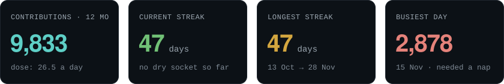


Taken every morning by a nurse who is actually a GitHub Action. Private work is counted, but it stays under the drape.

## 😬 The last four weeks, as an OPG


Today is always the lower right seven. The wisdom teeth carry no data; they are impacted on principle.

## 🧰 On the tray

<a href="https://github.com/MIC-DKFZ/nnUNet" title="nnU-Net: does the cutting"></a><a href="https://github.com/Project-MONAI/MONAI" title="MONAI: delivers the dose"></a><a href="https://github.com/Slicer/Slicer" title="3D Slicer: for a good look"></a><a href="https://github.com/SimpleITK/SimpleITK" title="SimpleITK: heavy lifting"></a><a href="https://github.com/pydicom/pydicom" title="pydicom: pokes at tags"></a><a href="https://github.com/wasserth/TotalSegmentator" title="TotalSegmentator: grabs everything"></a><a href="https://github.com/AImageLab-zip/ToothFairy" title="ToothFairy: the specimens"></a>

Tray 01, sterile until proven otherwise. Count in: 7, count out: 7. I lean a lot on other people's great work, and every instrument takes you to it.

  
  
  
  
  
  
  
  
  
  
  

## 📚 Dental history

- **Thesis, 2026.** *Validating automated measurement of the mandibular third molar to inferior alveolar canal relationship on CBCT.* MClinDent (Oral Surgery), UCL Eastman Dental Institute. Submitted, under examination.
- **Manuscript, 2026.** *Automated measurement of the third molar to inferior alveolar canal relationship: audit, public-data retraining and blind verification.* Written, and waiting for me to pick a journal.
- **2020–21.** A few papers on N95 masks, mouthwashes, root canals and cephalometrics, back when I had more free evenings.

## 🪥 Side quests

- **[fc-apple-skin](https://github.com/IbraAFK/fc-apple-skin)**: an Obsidian plugin that makes Full Calendar Remastered look and behave like Apple Calendar. Display only. It never writes to your calendars.
- **This page.** The radiographs redraw themselves every morning from [`scripts/build.py`](scripts/build.py). Help yourself if you want an OPG of your own commit history.

📋 Post-op instructions

 

- No spitting, no straws and no force-pushing to main for 24 hours.
- Bite down on the gauze. Not on the reviewer.
- Swelling peaks at day two or three. So does scope creep.
- If bleeding persists, apply firm pressure. If a bug persists, apply tests.
- Numbness that outlasts the local is my problem. A build that outlasts your patience is yours.
- Floss. I can tell.

Every image here is drawn from scratch. No patient data, no real radiographs, and no teeth were harmed in the making of this README.

